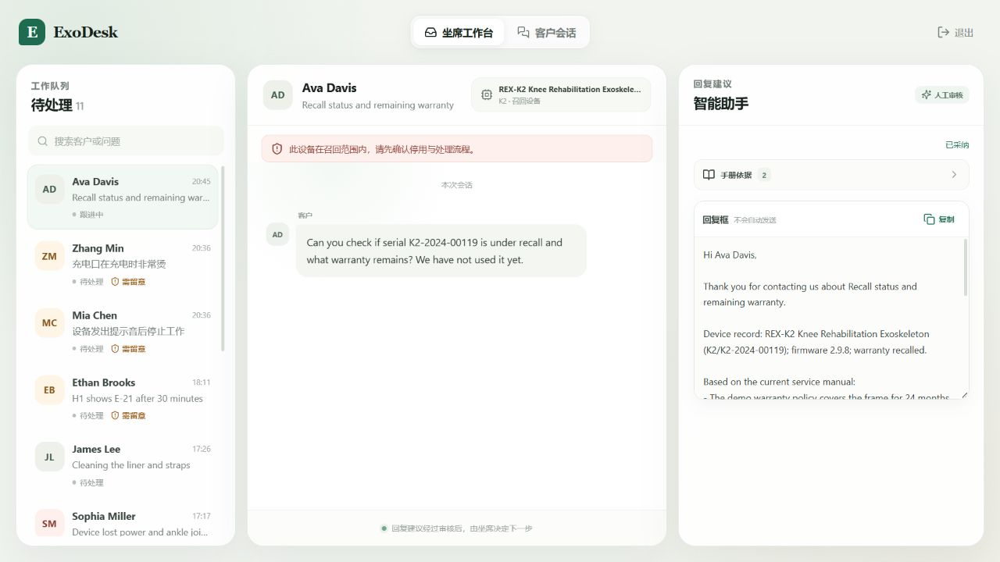
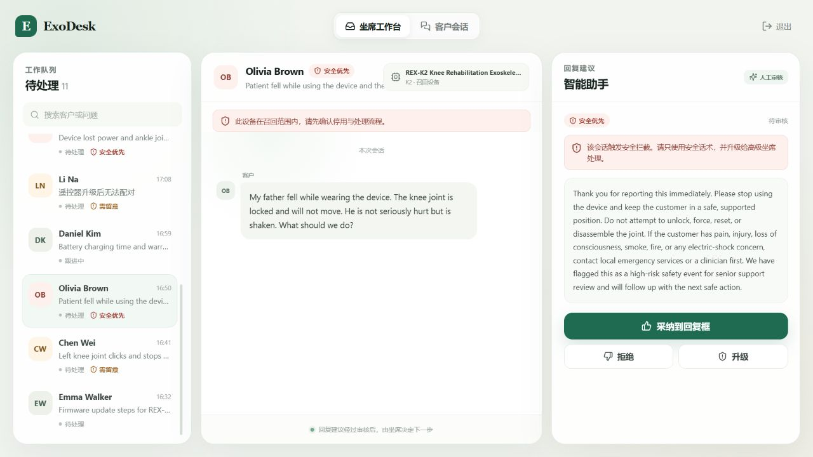
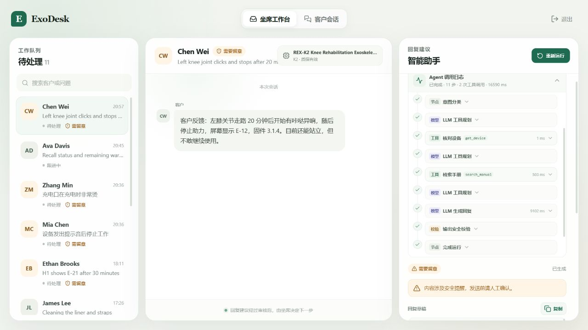
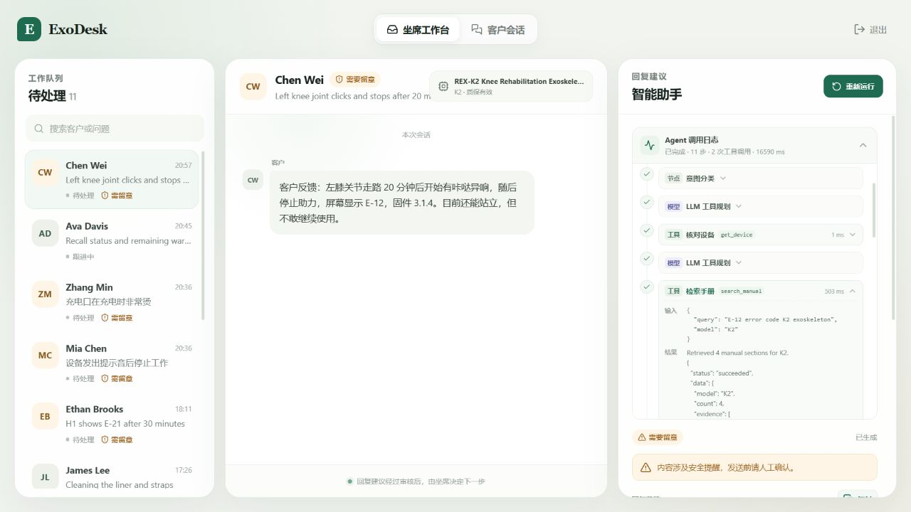
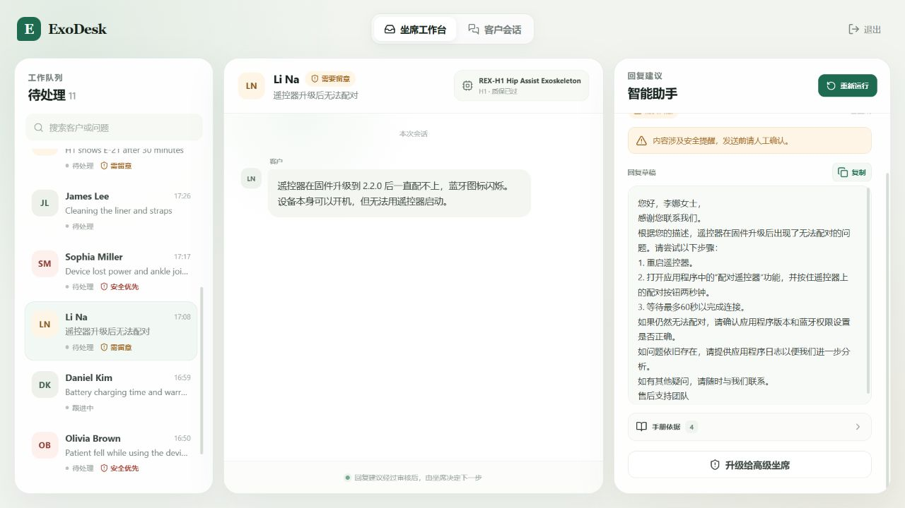

# U7 前端基座与坐席工作台验收

状态：**已人工验收**（2026-10-31）。U8 已在此基础上继续实现虚拟客户会话端。

## 本单元范围

- React 19、TypeScript、Vite 前端基座，提供访问码登录和会话内保持登录。
- 两个平行入口：坐席工作台、虚拟客户会话端。U7 先完成坐席端，客户端保留清晰的待开放页面。
- 工单队列默认只显示未关闭工单，支持选择、加载中、空状态和失败重试。
- 工单详情展示客户、问题、设备型号、序列号、保修、召回提示和消息记录。
- Agent 面板右上角常驻“启动 Agent / 重新运行”，不受已有草稿状态影响。
- Agent 调用日志支持整体折叠和单步折叠：默认只显示节点、工具名、状态和耗时，点击单步后展开输入参数与真实输出，再次点击收起。
- 运行中自动展开当前步骤，运行完成后恢复为摘要列表；页面刷新后重新加载已完成运行的步骤。
- 普通工单由 LLM 自主规划下一步工具并生成回复；日志记录模型名、规划理由、工具参数、Token 用量和真实返回。
- Agent 建议展示手册证据、风险等级、待补充信息、草稿状态和生成进度。
- 回复草稿旁直接提供复制按钮，不设置采纳或拒绝动作；不满意时重新运行。
- 唯一保留的审核动作是“升级给高级坐席”，提交前有二次确认。
- 同一工单正在生成时会接入已有运行进度。
- SSE 展示 Agent 的实时步骤，连接中断时给出明确提示，不伪装为成功。
- 桌面、窄屏和移动端断点；支持 `prefers-reduced-motion` 和屏幕阅读器状态播报。

## 本单元不包含

- 虚拟客户端的真实会话页、客户消息发送和双端实时联动（U8）。
- 后端账号体系、角色权限和正式登录鉴权。当前访问码只是本地 Demo 前端门禁。
- Zendesk 远端写操作。所有展示和操作仍使用合成数据与本地镜像。

## Agent 运行链路

1. 加载工单、设备与对话上下文，先执行确定性安全风险门。
2. 普通与需留意工单进入 `qwen-max` 工具规划：模型从工具白名单中选择下一个工具，或判断证据已足够并结束。
3. 工具参数经过 Pydantic 校验，执行结果写入步骤日志；未选工具、重复工具、未知工具和参数错误都不会绕过后端约束。
4. 取得手册证据后，由 `qwen-max` 基于工单、设备、对话和检索证据生成客户摘要与最终回复；最终回复必须翻译回客户最近一条原文消息的语言，签名也随回复语言本地化。
5. 模型文本统一清洗字面量换行、JSON 转义残片和签名格式；输出安全校验再独立检查剩余异常。
6. 不安全内容、信息不足或模型不可用时回退到确定性安全草稿。
7. 高风险、摔倒、锁死、冒烟、受伤等场景仍由确定性安全兜底直接处理，不调用 LLM 规划或回复生成。

模型返回的工具名、参数、理由、真实结果与 Token 用量都会进入 Agent 步骤日志。当前模型为 `qwen-max`。

## LLM 配置边界

- `LLM_ENABLED=true`：启用真实模型规划与回复生成。
- `LLM_API_KEY`：只保存在后端 `.env`，不会进入前端包、接口响应或步骤日志。
- `LLM_BASE_URL`：默认使用 DashScope OpenAI 兼容接口。
- `LLM_MODEL=qwen-max`：当前回归使用的模型。
- `LLM_TIMEOUT_SECONDS`、`AGENT_MAX_TOOL_CALLS`、`TOOL_TIMEOUT_SECONDS`：分别限制模型请求、工具调用次数和单次工具执行时长。
- 模型请求失败、返回格式异常、选择未知/重复工具或工具参数校验失败时，系统会记录回退步骤并使用确定性安全链路。

## 页面入口

```powershell
cd "D:\工单agent项目\backend"
$env:PYTHONIOENCODING="utf-8"
.\.venv\Scripts\python.exe -m uvicorn app.main:app --host 127.0.0.1 --port 8000
```

另开终端：

```powershell
cd "D:\工单agent项目\frontend"
pnpm dev --host 127.0.0.1
```

访问 `http://127.0.0.1:5173`，访问码 `123456`。

## 自动检查

```powershell
cd "D:\工单agent项目\frontend"
pnpm typecheck
pnpm build
```

本次结果：前端类型检查通过；生产构建通过，构建产物约为 `256.49 kB` JS 和 `26.37 kB` CSS；后端全量测试 `40 passed`。

## 浏览器回归结果

- 登录页：错误访问码提示正常；`123456` 可进入工作台；退出后回到登录页，重新登录正常。
- 工作台：三栏信息层级正常，当前显示 11 张未关闭工单，已解决工单不进入队列。
- Agent 控制：右上角始终可见“启动 Agent / 重新运行”；直接从页面点击“重新运行”成功创建新运行并实时追加日志。
- 真实模型运行：默认首张工单 `T-2402` 使用 `qwen-max` 完成 11 个步骤、3 次 LLM 规划、`get_device` 与 `search_manual` 两次工具调用和 1 次 LLM 回复生成，累计 6,448 Token；页头显示模型、风险与运行状态，工具行显示原始工具名、参数和真实检索结果。
- 日志折叠：展开 Agent 日志后，11 个步骤默认收起；点击“加载工单上下文”可单独展开并再次收起；点击 `search_manual` 可看到工具参数和真实检索结果，其他步骤不受影响。
- 回复语言：中文工单 `T-2405` 的工具规划、术语处理和手册检索过程保持不变，最终草稿完整输出中文，签名同步为“售后支持团队”；英文客户的最终回复继续使用英文。
- 真实回复结果：`T-2402` 的 E-12 解释、停用建议和保修到期日均来自设备档案与手册证据；`T-2409` 的召回批次和过期保修同样通过真实模型回归。输出安全校验通过，手册证据带页码。
- 输出清洗：字面量 `\n`、`\r`、多余 `">` 转义残片和签名引号已自动清理，安全校验仍会拦截残留序列化残片。
- 旧运行兼容：修复短任务耗时受数据库秒级时间精度影响而显示负数的问题，历史负值已归零。
- 复用已有运行：刷新页面后，历史运行仍会重新加载步骤，不再出现“只有草稿、没有调用日志”的断档。
- 普通工单：手册证据可折叠；草稿旁提供复制按钮，复制后显示“已复制”。
- 回复操作：底部只保留“升级给高级坐席”；升级确认弹窗、备注输入和取消操作正常。
- 高风险工单 `T-2403`：出现“安全优先”和“该会话触发安全拦截”提示，草稿只包含停止使用与升级安全话术。
- 客户会话入口：待开放页面可正常往返，不暴露内部开发单元编号。
- 浏览器控制台：无 `error` 或 `warn` 级别日志。
- 当前桌面截图为 `1280 × 720`；CSS 已提供 `1080px` 和 `760px` 两级布局切换。

## 视觉验收图

- 登录页：`docs/review-assets/u7-login.png`
- 坐席工作台：`docs/review-assets/u7-workbench.png`
- Agent 日志收起态：`docs/review-assets/u7-run-log-collapsed.png`
- Agent 日志展开态：`docs/review-assets/u7-run-log-expanded.png`
- 每一步结果明细：`docs/review-assets/u7-step-results.png`
- 日志单步折叠态：`docs/review-assets/u7-collapsible-steps.png`
- 单步展开工具结果：`docs/review-assets/u7-step-expanded.png`
- 中文客户最终回复：`docs/review-assets/u7-reply-language-zh.png`
- LLM 运行日志：`docs/review-assets/u7-qwen-max-log.png`
- LLM 工具调用与结果：`docs/review-assets/u7-qwen-max-tool-result.png`
- LLM 工具规划：`docs/review-assets/u7-qwen-max-planner-log.png`
- LLM 回复生成：`docs/review-assets/u7-qwen-max-reply-log.png`
- 精简后的复制与升级操作：`docs/review-assets/u7-simplified-actions.png`
- 升级给高级坐席确认：`docs/review-assets/u7-escalate-modal.png`
- 高风险工单：`docs/review-assets/u7-high-risk.png`
- 客户会话入口：`docs/review-assets/u7-customer-placeholder.png`











## 验收清单

- [x] 使用 `123456` 能进入工作台，退出后无法继续访问工作台。
- [x] 工单队列只显示待处理工单，切换工单时详情和 Agent 建议同步切换。
- [x] 设备档案、召回提示、消息记录在桌面和窄屏下都不溢出、不明显拥挤。
- [x] Agent 运行中能看到步骤；完成后显示带手册证据的待审核草稿。
- [x] 无论当前是否已有草稿，右上角都能看到启动或重新运行入口。
- [x] 展开“Agent 调用日志”先看到每一步摘要；点击单步才显示输入参数与真实结果，再次点击可收起。
- [x] 普通工单的日志显示 `qwen-max`、`LLM 工具规划` 和 `LLM 生成回复`，工具行显示原始工具名。
- [x] 中文客户收到完整中文回复，英文客户收到完整英文回复，签名语言与正文一致。
- [x] 草稿旁可直接复制完整回复，复制状态反馈正常。
- [x] 回复区只保留“升级给高级坐席”，升级有确认弹窗；不显示采纳或拒绝操作。
- [x] 高风险工单有明显安全提示，话术不包含自行拆机、复位或继续使用指引。
- [x] “客户会话”入口可打开并返回，不出现内部开发术语。
- [x] 页面整体简洁，未被日志、调试字段或重复正文干扰。

## 关键文件

- `frontend/src/App.tsx`
- `frontend/src/components/Login.tsx`
- `frontend/src/features/workbench/Workbench.tsx`
- `frontend/src/features/workbench/TicketList.tsx`
- `frontend/src/features/workbench/Conversation.tsx`
- `frontend/src/features/workbench/AgentPanel.tsx`
- `frontend/src/features/workbench/CustomerPlaceholder.tsx`
- `frontend/src/lib/api.ts`
- `frontend/src/styles.css`

## 已知边界

- 当前是单机 Demo，SSE 运行进度依赖后端数据库轮询。
- 刷新页面后会重新选择队列第一张工单，不保留上次选中的工单；但会重新加载该工单最近一次运行的完整步骤。
- 登录状态仅保存在当前标签页的 `sessionStorage`，不是正式鉴权。
- 真实模型依赖外网与 API 配额；不可用时自动回退，不影响后端完成一次可审计的运行。
- 当前使用 `qwen-max`，每次运行都会产生模型调用费用和 Token 用量。
- 最终回复语言由 LLM 提示词约束；确定性安全兜底仍沿用原有英文模板，未做独立语言翻译。
- U7 未实现客户消息发送，仍需进入 U8 完成第二个真实端。
