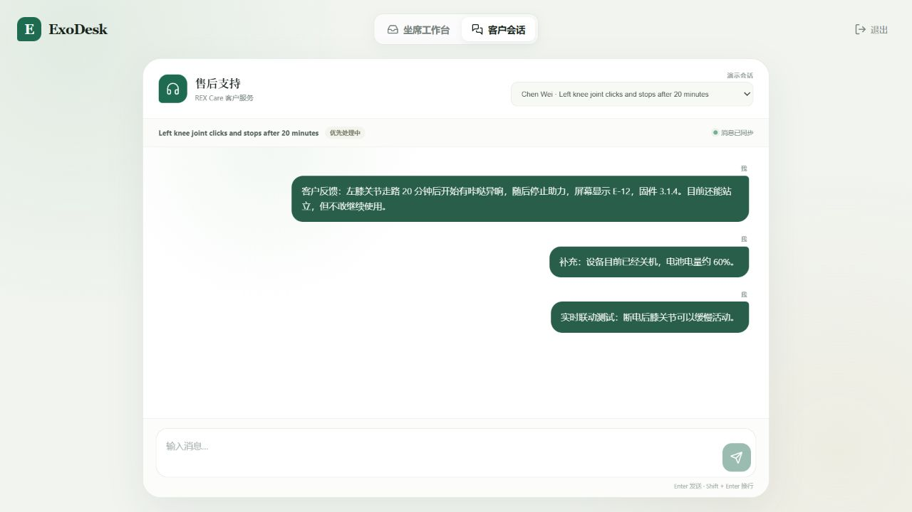
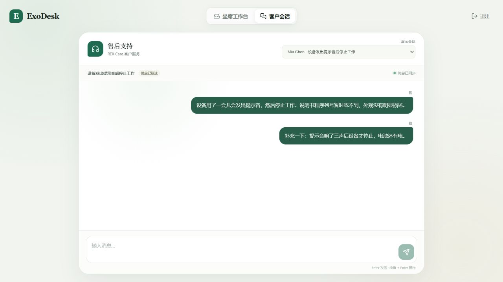
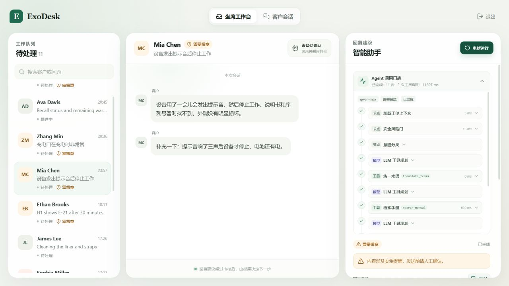

# U8 虚拟客户会话端与双端联动验收

状态：**已人工验收**（2026-11-01）。U9 已开始实现坐席发送消息。

## 本单元范围

- 完成第二个真实端：客户会话页。客户可查看演示会话、读取真实消息记录并发送消息。
- 客户消息写入现有会话记忆，和坐席工作台共用同一份后端数据。
- 票级 SSE 实时推送客户可见消息，坐席端和客户端无需刷新即可互相看到新消息。
- Agent 运行状态通过票级 SSE 实时同步到客户会话页：正在处理、优先处理、已转交高级坐席、消息已送达。
- SSE 断线时显示“正在重新连接”，不会把断线伪装成同步成功。
- 消息按 ID 去重，发送中禁用输入，失败时给出可读提示并保留用户输入。
- 支持 Enter 发送、Shift + Enter 换行、中文输入法组合态不误发。
- 桌面与窄屏响应式布局；客户端只保留会话必需信息。
- 票级事件只暴露工单状态、优先级、最近运行状态和草稿状态，不暴露草稿正文、手册证据、Agent 日志或内部备注。

## 本单元不包含

- 正式账号、角色权限和多租户隔离。访问码仍只是本地 Demo 门禁。
- Zendesk 真实远端发消息与写回；当前所有消息都进入本地镜像。
- 客户端查看 Agent 调用日志或回复草稿。它们属于坐席内部工作区，不应出现在客户可见端。
- 多实例横向扩展。当前 SSE 通过数据库轮询实现，适合单机演示。

## 接口与事件

| 方法 | 路径 | 说明 |
|---|---|---|
| GET | `/api/tickets/{ticket_id}/events?after=N` | 工单级 SSE，支持 `Last-Event-ID` 续传 |
| POST | `/api/tickets/{ticket_id}/messages` | 客户发送消息，复用会话记忆与幂等能力 |

票级 SSE 事件：

- `ticket`：`id`、`status`、`priority`、`updated_at`、`latest_run_status`、`latest_draft_status`。
- `message`：只包含 `customer` 与 `agent` 角色；事件 `id` 为消息 ID，可用于断线续传。
- `error` / `timeout`：工单消失或连接达到服务端时长上限。

安全边界：

- 后端查询直接限定 `Message.role.in_(("customer", "agent"))`，`internal_note` 不会进入客户事件流。
- `ticket` 事件只携带状态枚举，不携带 `draft_text`、`customer_summary`、`evidence`、Token 或错误详情。
- API Key 只保存在后端 `.env`，不进入前端包、接口响应或客户事件。

## 页面交互

- 顶部两个入口保持平行：`坐席工作台`、`客户会话`。
- 客户端顶部只显示售后身份、演示会话选择和当前处理状态。
- 消息区只显示客户与售后消息，不展示内部备注、模型信息或调试字段。
- 输入框只保留发送按钮和 Enter / Shift + Enter 提示，不出现多余操作。
- 坐席端点击“重新运行”后，客户端的处理状态会在下一轮 SSE 推送时自动变为“正在处理”。
- 运行结束或草稿状态变化后，客户端状态自动同步，不需要刷新或切换会话。

## 本次自动检查

```powershell
cd "D:\工单agent项目\backend"
$env:PYTHONIOENCODING="utf-8"
.\.venv\Scripts\python.exe -m pytest -q

cd "D:\工单agent项目\frontend"
pnpm typecheck
pnpm build
```

结果：

- 后端全量测试：`48 passed`。
- 前端类型检查：通过。
- 生产构建：通过，JS `262.01 kB`、CSS `30.91 kB`。
- 新增安全回归：客户 SSE 能看到工单与运行状态，但看不到 `internal_note` 和草稿正文。
- 后端与前端版本统一为 `0.8.0`。

## 浏览器回归结果

- 访问码 `123456` 登录成功，客户端能加载真实消息。
- 客户端切换演示会话正常；当前消息历史在后端存在时立即显示。
- 在客户端发送“补充一下：提示音响了三声后设备才停止，电池还有电。”成功，坐席窗口无需刷新即出现同一条消息。
- 在坐席窗口点击“重新运行”后，客户端在约 1 秒内自动从“消息已送达”切换为“正在处理”。
- `qwen-max` 运行完成后，客户端自动恢复为“消息已送达”；坐席端显示 11 步、2 次工具调用和真实工具名。
- 客户端与坐席端控制台均无 `error` / `warn` 日志。
- 客户端仅显示客户需要看到的状态与消息，没有出现草稿、证据、Token、模型名或内部备注。

## 本次验证用合成数据

- `T-2402` 保留此前双端联调写入的两条中文测试消息，作为早期联动证据。
- `T-2411` 新增一条客户测试消息和一次 `qwen-max` 运行，用于验证 Agent 状态实时同步及完成后回落。
- 这些数据均为本地 Demo 合成数据，不属于真实客户数据。

## 视觉验收图

- 客户端空闲态：`docs/review-assets/u8-customer-idle.png`
- 客户端发送后：`docs/review-assets/u8-customer-sent.png`
- 客户端实时处理中：`docs/review-assets/u8-customer-processing.png`
- 客户端完成后：`docs/review-assets/u8-customer-complete.png`
- 坐席端实时日志：`docs/review-assets/u8-agent-live.png`








## 验收清单

- [x] 使用 `123456` 登录后，`坐席工作台` 与 `客户会话` 两个入口都能正常打开和返回。
- [x] 客户端能显示真实历史消息，切换演示会话后消息与标题同步切换。
- [x] 客户端可发送消息，Enter 发送、Shift + Enter 换行、发送失败提示均正常。
- [x] 客户发送后，另一个坐席窗口无需刷新即可看到新消息。
- [x] 坐席端启动或重新运行 Agent 后，客户端自动显示“正在处理”，完成后自动回落。
- [x] Agent 升级草稿后，客户端能显示“已转交高级坐席”，但不看到草稿内容。
- [x] 客户端不显示 Agent 日志、模型名、Token、手册证据、内部备注或调试字段。
- [x] 连接中断时客户端显示重连状态，恢复后继续同步消息。
- [x] 桌面与窄屏下输入区、消息气泡和演示会话选择都不溢出。
- [x] 页面整体简约，客户只看到售后身份、会话状态、消息和输入框。

## 关键文件

- `backend/app/api/tickets.py`
- `backend/app/api/sse.py`
- `backend/tests/test_api.py`
- `frontend/src/features/workbench/CustomerChat.tsx`
- `frontend/src/features/workbench/Workbench.tsx`
- `frontend/src/lib/api.ts`
- `frontend/src/types.ts`
- `frontend/src/styles.css`

## 已知边界

- 当前 Agent 状态是粗粒度状态同步，不向客户暴露实时步骤；这是有意的安全边界。
- 客户消息写入后不会自动触发 Agent，仍由坐席在工作台启动或重新运行。
- SSE 连接寿命受服务端超时限制；浏览器会按 EventSource 语义自动重连，消息游标用于续传。
- 当前使用本地演示会话选择器，尚未接入真实客户登录或渠道会话映射。
